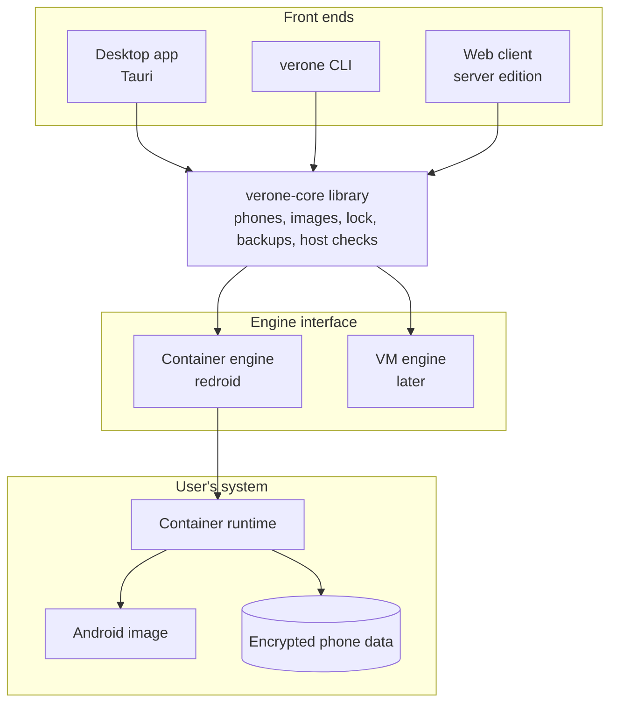

# Architecture

Status: **draft for owner review** (2026-11-14). Anything marked *unverified* is tracked
in `assumptions.md` and must be tested before code depends on it.

## Overview



Three layers:

1. **Front ends** show the phone and take commands. They contain no phone logic.
2. **`verone-core`** owns every rule: what a phone is, where its data lives, how it is
   locked, how the host is checked. The command line, desktop app and server all call it.
3. **Engines** run Android. Each engine implements the same interface, so the rest of
   Verone does not know whether a phone is a container or a virtual machine.

## What a "phone" is

A phone is three things, stored per user:

| Part | Content | Location (Linux) |
|---|---|---|
| Profile | Name, engine, Android version, screen size, options. A small text file. | `~/.local/share/verone/phones/<id>/phone.toml` |
| System image | Read-only Android system, shared by all phones using the same version. | Managed by the container runtime |
| Data | Everything the user adds: accounts, apps, files. Encrypted at rest. | `~/.local/share/verone/phones/<id>/` |

Consequences:

- **Stop and start** keeps the data, so the phone resumes as it was.
- **Factory reset** deletes the data and keeps the profile; the next boot runs first-time setup.
- **Backup** is an encrypted archive of profile plus data. **Clone** and **snapshot** are copies of the data.
- **Updating Android** replaces the system image without touching the data.

## Engine interface

Every engine must provide these operations. Names are indicative; the exact Rust trait
is written in Phase 1.

| Operation | Meaning |
|---|---|
| `check_host` | Report whether this machine can run the engine and what is missing. |
| `prepare_image` | Make the requested Android image available locally. |
| `create` / `destroy` | Create or remove a phone's runtime resources. |
| `start` / `stop` | Boot or shut down. A restart requested inside Android must bring the phone back. |
| `status` | Stopped, booting, running, or failed with a reason. |
| `control_endpoint` | Where the debug connection (adb) for this phone can be reached. |
| `capabilities` | What this engine supports on this host: GPU, camera, audio, root, security fidelity. |

### Container engine (first)

Built on redroid: a standard Android system running in a container that shares the
host's Linux kernel.

Verified on the owner's machine on 2026-11-13 (Arch Linux, kernel 7.2, Docker 29.9,
image `redroid/redroid:14.0.0-latest`):

- Boots to the home screen in 23 s; about 860 MB RAM; about 3.5% of one core when idle.
- `adb` and scrcpy 5.0 connect and display the phone.
- The kernel's built-in binder driver is sufficient; no extra kernel module was needed.
- A restart chosen inside Android stops the container (exit code 129). The engine must
  start it again automatically.
- A power-off chosen inside Android stops it with exit code 130. The runtime's own
  stop command does not shut Android down; it kills it after the grace period. The
  engine stops a phone by powering Android off from inside.
- Android fails to boot if its data location has no free space. `check_host` must test
  free space before starting.
- The stock image is a `userdebug` build with test keys, an old-style launcher and no
  setup wizard. A phone-like first boot needs image work (Phases 3 and 5).

From the redroid documentation (not yet tested here):

- Images exist for Android 8.1 through 16.
- Display size, density, frame rate, GPU mode, DNS and proxy are set with
  `androidboot.redroid_*` start parameters. `ro.*` properties can be overridden the same way.
- GPU modes are `guest` (software), `host` (accelerated) and `auto`.
- Published images already include an ARM translation layer.
- The container runs privileged. The debug port must never be exposed to a network.

Limits of this engine, to be stated in the app:

- It shares the host kernel, so kernel-level behaviour is the host's, not a phone's.
- It needs a privileged container. Anyone who can control the container runtime
  effectively has administrator rights on the host.
- Android's own security layers (verified boot, hardware-backed keys, strict SELinux)
  are absent or weakened. Security findings made here do not automatically apply to a
  real phone.

### VM engine (later)

A virtual machine with its own Android kernel, intended for full fidelity and as the
basis for Windows. Candidate: Google's Cuttlefish. Design is deferred to its phase; the
only requirement now is that nothing above the engine interface assumes containers.

## Display and input

- **Phase 1:** the command line launches the system's scrcpy in its own window.
- **Phase 2:** the desktop app shows the phone inside its own window with a side toolbar.
  How the video is embedded is an open design question, decided by a short experiment at
  the start of Phase 2 (assumption A-13). Options: decode the scrcpy stream inside the
  app, or manage a scrcpy window as a child of the app.
- **Server edition:** video and input travel over an authenticated, encrypted connection
  to a browser or the desktop app.

## Debug connection (adb)

redroid's adb must be treated as an unauthenticated administrator door into the phone.

- It is never published on a network interface.
- Preferred design: do not publish a port at all; reach adb through the container
  runtime. This was shown to work on 2026-11-13 (a local bridge into a container that
  had no network). To be hardened in Phase 1.
- Developers who want their IDE to see the phone opt in to a port bound to `127.0.0.1` only.

## Verone lock

- Phone data is encrypted at rest. The key is derived from the Verone password and is
  never written to disk.
- Locking stops the phone and closes the encrypted storage; hiding the window is not locking.
- Auto-lock after a configurable idle time.
- Backups are encrypted with the same scheme.
- Mechanism verified in Phase 0 (assumption A-09): an encrypted folder served by
  gocryptfs running as root in a helper that shares the host's process namespace. It
  needs only FUSE. An encrypted disk image (LUKS) is the alternative still to be
  compared; it needs a kernel module that many desktops do not have loaded.
- Contents and names are encrypted. Ownership, sizes and the shape of the folder tree
  are not hidden.

## Google apps

- Never part of Verone's package or images (D-008).
- If the user chooses "with Google" at first run, Verone downloads an open-source-community
  Google apps package to the user's machine, builds a local image from it, and guides
  the user through Google's own device registration page.
- "Without Google" is a complete mode (D-014).

## Host adaptation

`check_host` runs before anything else and drives what the app offers:

| Check | If missing |
|---|---|
| Container runtime installed and usable | Show the install command for the user's distribution. |
| Kernel binder support | Explain which kernel or module is needed. |
| Running kernel matches installed kernel modules | Ask for a reboot (this exact fault occurred on 2026-11-13). |
| Free disk space, checked separately where the runtime stores images and where phone data lives (these were different partitions on the reference machine) | Refuse to start and say how much is needed and where. |
| Usable GPU for acceleration | Fall back to software rendering and say so. |
| Free RAM | Warn, or suggest a smaller screen size. |
| Webcam, microphone | Hide the related features. |

## Dependency policy

| Component | How it reaches the user |
|---|---|
| `verone` binaries and app | In the Verone package. |
| Container runtime | System package, installed by the user; Verone checks and guides. |
| adb, scrcpy | System packages in Phase 1. Whether to bundle them later is decided in Phase 2. |
| Android system image | Downloaded on first use, per Android version. |
| Google apps | Downloaded only if the user opts in. |

## Repository layout (proposed, depends on D-011)

```
verone/
  crates/
    verone-core/     phones, images, lock, backups, host checks, engine interface
    verone-engine-container/
    verone-cli/
  app/               Tauri desktop app
  docs/
  tests/
```
