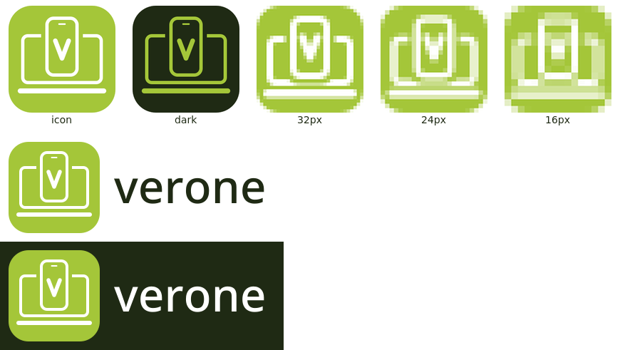

# Verone brand

The Verone mark is an Android phone rising out of a laptop: a phone that runs on
your PC, laptop or server.

## Files

| File | Use |
| --- | --- |
| `verone-icon.svg` | The icon, 48 px and larger |
| `verone-icon-small.svg` | The icon at 32 px and smaller (heavier lines, no speaker) |
| `verone-icon-dark.svg` | The icon on dark backgrounds |
| `verone-logo.svg` | Icon and name, on light backgrounds |
| `verone-logo-on-dark.svg` | Icon and name, on dark backgrounds |
| `verone.ico` | Windows icon, 16 to 256 px |
| `png/` | PNG exports of the above |
| `terminal/` | The mark for terminal output: large, small and plain ASCII |

Run `terminal/preview.sh` to see the terminal versions in colour.

## Colours

| Name | Hex |
| --- | --- |
| Verone green | `#A4C639` |
| Dark green | `#1F2A14` |
| White | `#FFFFFF` |

White text on Verone green is too low in contrast for body text; use dark green.

## Type

The name is set in Noto Sans Medium (SIL Open Font License) and converted to
outlines, so the logo files need no font installed.
